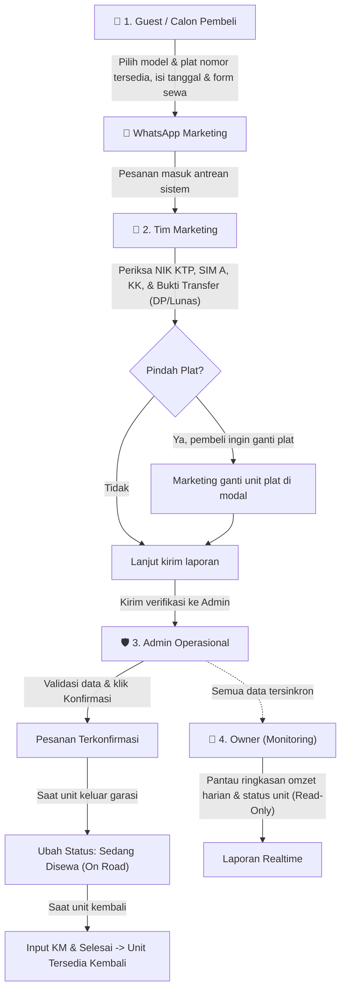

# 🚗 Elha RentCar - Sistem Rental Mobil & Multi-Role Workflow

Aplikasi web modern berbasis **Laravel 11**, **Inertia.js v3**, **React 19**, dan **TypeScript** untuk operasional rental mobil **Elha Rent Car Subang**. Sistem ini mengintegrasikan alur pemesanan publik via WhatsApp hingga alur verifikasi bertingkat antara Marketing, Admin Operasional, dan Owner.

---

## 📌 Spesifikasi & Tech Stack

| Komponen              | Spesifikasi / Teknologi                                    | Catatan                                                  |
| :-------------------- | :--------------------------------------------------------- | :------------------------------------------------------- |
| **PHP Version**       | **PHP ^8.4** (Disarankan `8.4.x` atau `8.5.x`)             | ⚠️ **Wajib >= 8.4.1** (karena dependensi Symfony v8.1)   |
| **Backend Framework** | Laravel 11 / 12                                            | RESTful routes, Middleware Role, Form Request, Eloquent  |
| **Frontend Stack**    | React 19 + Inertia.js v3 + TypeScript                      | Single Page Application (SPA) tanpa refresh halaman      |
| **Styling & UI**      | Tailwind CSS v4, Lucide Icons, Radix UI, Sonner            | Dark mode native, fully responsive (Mobile & Desktop)    |
| **Build Tool**        | Vite Plus (`vp`) / Vite 6                                  | Kompilasi ultra-cepat dengan TypeScript & Babel compiler |
| **Database**          | SQLite (Default lokal & CI) / MySQL                        | Zero config, file sqlite otomatis dibuat                 |
| **Testing & CI**      | PHPUnit (51 Tests), PHPStan (Level 5), Laravel Pint, Biome | Terintegrasi otomatis di GitHub Actions CI               |

---

## 🚀 Panduan Setup & Menjalankan di Laravel Herd

Jika Anda atau teman Anda menggunakan **[Laravel Herd](https://herd.laravel.com/)** di Windows atau macOS, ikuti langkah mudah berikut:

### 1. Clone Repository

Buka terminal (PowerShell / Git Bash / Command Prompt), arahkan ke folder workspace Anda:

```bash
git clone https://github.com/YuCvn/elha-rentcar.git
cd elha-rentcar
```

### 2. Atur Versi PHP di Herd

> [!IMPORTANT]
> Proyek ini menggunakan komponen Symfony 8.1 yang mewajibkan **PHP 8.4 atau lebih baru**.

1. Buka aplikasi **Laravel Herd**.
2. Buka menu **Settings** > **PHP**.
3. Pastikan versi **PHP 8.4** sudah terinstal. Jika belum, klik **Install** pada PHP 8.4.
4. Pada tab **Sites**, klik folder `elha-rentcar` dan pastikan PHP Version dipilih ke **8.4**.

### 3. Setup File Environment

Salin template konfigurasi `.env`:

- **Windows (PowerShell):**
    ```powershell
    Copy-Item .env.example .env
    ```
- **macOS / Linux / Git Bash:**
    ```bash
    cp .env.example .env
    ```

### 4. Install Dependensi PHP & Generate App Key

```bash
composer install
php artisan key:generate
```

### 5. Inisialisasi Database SQLite & Data Awal (Seeder)

Buat file SQLite dan jalankan migrasi beserta data sampel armada mobil & akun pengujian:

- **Windows (PowerShell):**
    ```powershell
    New-Item -ItemType File -Path database\database.sqlite -Force
    php artisan migrate --seed
    ```
- **macOS / Linux / Git Bash:**
    ```bash
    touch database/database.sqlite
    php artisan migrate --seed
    ```

### 6. Install Dependensi Node.js & Jalankan Frontend

```bash
npm install
npm run dev
```

### 7. Buka Aplikasi di Browser

Laravel Herd otomatis membuat domain lokal `.test`. Akses aplikasi di browser:
👉 **[http://elha-rentcar.test](http://elha-rentcar.test)**  
_(Jika menggunakan `php artisan serve`, buka di `http://127.0.0.1:8000`)_

---

## 👥 Akun Login Demo & Simulasi Cepat

Untuk mempermudah pengujian alur, tersedia akun siap pakai:

| Role                  | Email                  | Password   | Hak Akses Utama                                                   |
| :-------------------- | :--------------------- | :--------- | :---------------------------------------------------------------- |
| **Admin Operasional** | `admin@elha.co.id`     | `password` | Konfirmasi sewa, kelola armada, ubah status on-road/selesai       |
| **Marketing & Sales** | `marketing@elha.co.id` | `password` | Verifikasi KTP/SIM/KK, bukti bayar, opsi ganti plat mobil         |
| **Owner (Pemilik)**   | `owner@elha.co.id`     | `password` | **Read-Only**: Monitoring omzet, grafik armada, laporan transaksi |

> [!TIP]
> **Fitur Role Switcher Instan:**  
> Di bar navigasi bagian paling atas aplikasi, terdapat tombol pintas **Simulasi Workflow: `Guest (Pembeli)` | `Marketing` | `Admin` | `Owner`**. Anda bisa berpindah peran hanya dengan 1 kali klik tanpa perlu logout-login berulang kali.

---

## 🔄 Alur Kerja Sistem (Workflow)



### Penjelasan Tahapan Alur:

1. **Guest (Calon Penyewa):**
    - Calon pembeli mengunjungi katalog armada di halaman beranda.
    - Model kendaraan dikelompokkan unik (misal 3 unit Daihatsu Sigra hanya muncul 1 kartu model dengan indikator jumlah unit siap pakai).
    - Calon pembeli dapat melihat deskripsi lengkap, fitur, foto resolusi tinggi, serta memilih nomor plat spesifik yang berstatus _Tersedia_.
    - Mengklik tombol sewa langsung membuka chat WhatsApp Marketing dengan draf format pemesanan otomatis.

2. **Marketing:**
    - Menerima kontak dari WhatsApp dan membuka menu **Booking**.
    - Menginput data verifikasi: NIK KTP (16 digit), SIM A, Kartu Keluarga, dan mengunggah bukti pembayaran DP (50%) atau Lunas.
    - Jika calon penyewa berubah pikiran dan ingin memilih plat nomor unit lain dari model yang sama, Marketing dapat mengganti plat langsung dari dropdown tanpa membuat pesanan baru.
    - Mengirim berkas verifikasi ke Admin Operasional.

3. **Admin Operasional:**
    - Menerima notifikasi antrean verifikasi dari Marketing di Dashboard.
    - Melakukan pengecekan akhir dan menekan tombol **Konfirmasi Pesanan**.
    - Ketika penyewa mengambil mobil di garasi, Admin menekan tombol **Jalan (On Road)** untuk menandai mobil sedang keluar.
    - Ketika mobil dikembalikan, Admin menginput kilometer akhir dan mencatat pengembalian, status mobil otomatis kembali **Tersedia**.
    - Admin juga memiliki kendali penuh di menu **Armada** untuk menambah unit baru (bisa menyalin dari model yang ada) dan mengedit unit dengan **dropdown plat nomor yang berganti-ganti**.

4. **Owner (Pemilik Bisnis):**
    - Mengakses dashboard untuk memantau ringkasan omzet harian, statistik armada, dan riwayat transaksi.
    - Seluruh fitur pada akun Owner berstatus **Read-Only** untuk mencegah kesalahan klik/perubahan data transaksi. Jika tombol aksi tidak sengaja tertekan, sistem menampilkan notifikasi peringatan lembut berdurasi 1.5 detik tanpa menyebabkan error layar putih.

---

## 🛠️ Panduan Git & Kolaborasi (Push / Pull)

Bagi rekan pengembang yang ingin berkontribusi:

### Tarik Pembaruan Terbaru

```bash
git checkout main
git pull origin main
```

### Buat Branch Baru untuk Fitur / Perbaikan

```bash
git checkout -b fitur/nama-fitur
```

### Jalankan Pengecekan Kualitas Kode

Sebelum melakukan commit, pastikan seluruh linter, tipe TypeScript, dan unit test lolos:

```bash
# Jalankan format & linting frontend
npm run check:fix

# Jalankan pengecekan tipe TypeScript
npm run types:check

# Jalankan seluruh rangkaian test backend (Pint + PHPStan + PHPUnit)
composer ci:check
```

### Commit dan Push

```bash
git add .
git commit -m "feat: tambahkan fitur nama fitur"
git push origin fitur/nama-fitur
```

_(Setelah itu, buat Pull Request ke branch `main` di GitHub)_

---

## 📜 Perintah Penting (Cheat Sheet)

```bash
# Menjalankan Vite hot-reload frontend
npm run dev

# Kompilasi aset frontend untuk rilis/production
npm run build

# Menjalankan PHP Development Server (jika tidak pakai Herd)
php artisan serve

# Reset dan isi ulang database dari nol (PERHATIAN: menghapus seluruh data yang ada)
php artisan migrate:fresh --seed

# Menjalankan suite pengujian lengkap
composer ci:check
```

---

<div align="center">
  <sub>Dikembangkan dengan ❤️ untuk <strong>Elha Rent Car Subang</strong></sub>
</div>
